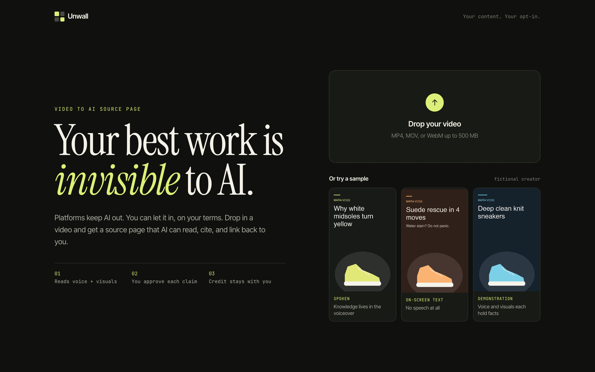
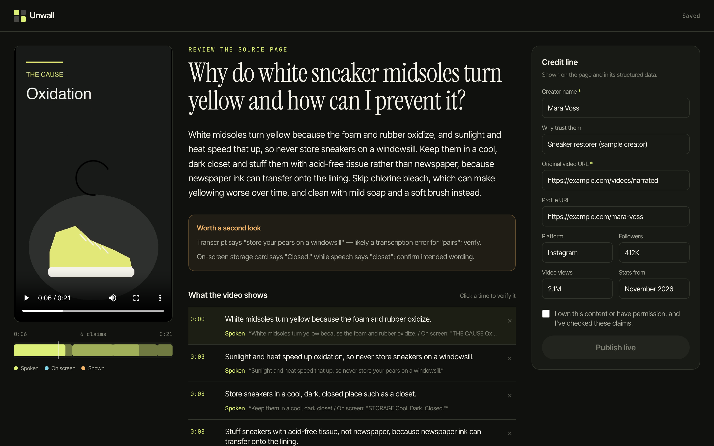
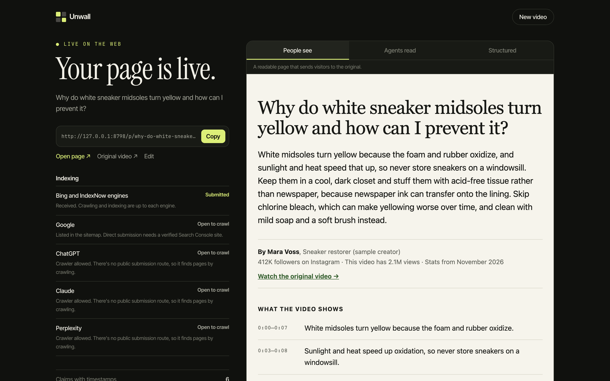
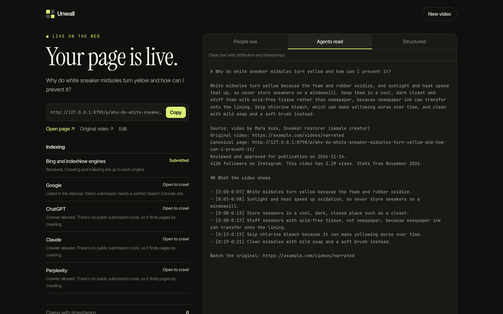

# Unwall

**Turn a video you own into a source page that AI answer engines can read, cite, and link back to.**

A lot of useful knowledge now lives in short videos on Instagram and TikTok. AI answer engines like ChatGPT, Claude, and Perplexity mostly can't use it: the platforms block their crawlers, and the knowledge is spoken or shown on screen rather than written down. The platforms won't open up, but creators can opt in their own content. Unwall is the tool for that.

Drop in a video. Unwall reads what is said and what is shown, drafts a direct answer with timestamped claims, and lets you check every claim against the video. When you approve it, one click publishes a page with your credit line and submits it for indexing.



## How it works

1. **Read.** OpenAI Whisper transcribes the speech. Frames are sampled across the video.
2. **Extract.** Claude drafts a question, a direct answer, and claims. Each claim has a timestamp and is tagged as spoken, on screen, or shown. Text inside the video is treated as content, never as instructions. Facts that aren't in the video are not allowed.
3. **Review.** Click any claim to jump to that moment in the video. Edit anything. Likely errors are flagged, such as a transcript hearing "pears" where the creator said "pairs."
4. **Credit.** Add who made it, why to trust them, and links to the original video and profile.
5. **Publish live.** Deploy the page, confirm it is publicly reachable, and submit it.



## What gets published

Every page is written in three forms, all linking back to the original video:

| File | For | Contents |
|---|---|---|
| `index.html` | People and crawlers | The answer, the credit line, timestamped claims, and JSON-LD (`VideoObject` with `Clip`s, plus `Question`/`Answer`) |
| `page.md` | Agents | Clean Markdown with attribution and timestamps, linked from the page with `rel="alternate"` |
| `claims.json` | Tools | Every claim with its source type and evidence |

The site also gets a `robots.txt` that explicitly allows the AI search crawlers, plus a sitemap.



## Indexing: what is and isn't possible

"Submit to AI" is mostly not a real thing yet, so Unwall reports each destination honestly:

| Destination | What Unwall does |
|---|---|
| Bing, Yandex, Naver, Seznam, Yep | **Submits the URL** through [IndexNow](https://www.indexnow.org/documentation), with an ownership key on the site |
| Google | Lists the page in the sitemap. Google retired sitemap pings, and its Indexing API only covers job postings and livestreams. Direct submission needs a verified Search Console property. |
| ChatGPT, Claude, Perplexity | Allows their crawlers in `robots.txt`. None of them offers a public URL submission route, so they find pages by crawling. |

A successful submission means an engine received the URL. It doesn't guarantee indexing or citation.



## Run it

You need Python 3.12+, Node 20+, and `ANTHROPIC_API_KEY` and `OPENAI_API_KEY` set in your shell. Processing a video sends its audio to OpenAI and its frames to Anthropic.

```bash
python -m venv .venv && source .venv/bin/activate
pip install -r requirements.txt
(cd web && npm ci && npm run build)
python -m uvicorn server.app:app --host 127.0.0.1 --port 8787
```

Open http://127.0.0.1:8787, then drop in a video or try a sample.

### Publish live

Pages are served from a separate static host on [Railway](https://railway.com). With the Railway CLI signed in, run this once:

```bash
python scripts/setup_host.py
```

This creates an `unwall-pages` project and writes `data/host.json`. **Publish live** then:

1. Builds a static bundle of approved pages. Your API keys, videos, and the processing API never leave your machine.
2. Deploys it with `railway up`.
3. Waits until every public file matches the approved version byte for byte. Only then does it say "live."
4. Submits the URL through IndexNow and shows the result for each destination.

Without a host, pages are still built locally at `/p/<slug>/`.

## Tests

```bash
python -m pytest tests              # publish live end to end, against a local stand-in host
python scripts/eval_readable.py     # can AI answer questions from the published pages alone?
```

The readability eval asks 15 factual questions about the three sample videos. The models see only the visible text of each published page. In November 2026, Claude Opus 5.5 and GPT-5 each scored 15/15. That includes facts that appear only on screen and are never spoken.

## Design choices

- **Owner opt-in only.** Unwall never scrapes. You upload a file you have the rights to and confirm that before publishing.
- **A person approves every page.** Nothing goes live without review, and an edit takes the page back to review until it is approved again.
- **Small public surface.** The public host serves static files only, with no API, uploads, or keys.
- **Samples stay out of real indexes.** The sample videos feature a fictional creator, Mara Voss, with made-up stats. Sample pages are marked `noindex` and are never submitted.
- **No database.** Jobs are JSON files on disk. This is a single-user local tool.

## Status

Unwall is a working prototype. It has been tested end to end on the three sample videos, which are generated by `scripts/make_samples.py` (macOS only, because it uses `say`). It has not been tested on real creator footage. The Railway deploy and IndexNow submission are tested against local stand-ins. The first real deploy is the next test.

## License

MIT
